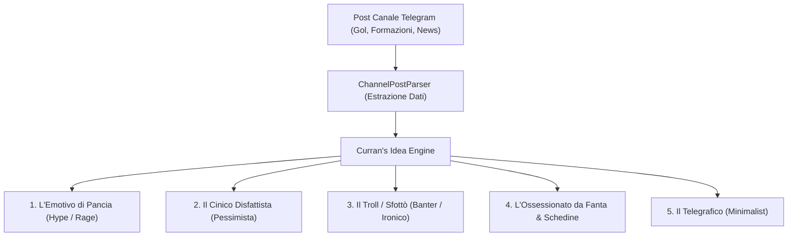

# Humans as Curran's Idea (v2.2)

[](LICENSE)
[](https://www.python.org/)

**Humans as Curran's Idea** è un motore euristico e comportamentale progettato per generare risposte realistiche da parte di bot sotto i post di canali Telegram a tema calcistico e Fantacalcio.

A differenza dei bot tradizionali (spesso rigidi, prolissi, con punteggiatura accademica e facilmente riconoscibili come IA), questo modello è stato calibrato analizzando ed elaborando **oltre 45 mila messaggi reali** da **oltre 1.240 utenti** di una vera community Telegram sportiva, e potenziato con un **Parser Semantico Intelligente per i Post di Canale** addestrato su oltre 1.400 post reali.

---

## 🧠 Parser Intelligente dei Post di Canale

L'algoritmo non riceve più soltanto stringhe generiche, ma esamina i post complessi del canale estraendo automaticamente i dettagli della partita e della notizia:

- **Post di GOL Live (`GOAL!`):** Estrae marcatore (`⚽️`), assistman (`👟`), minuto (`⏱️`), squadre (`🆚`) e risultato (`1-0`). I bot reagiscono menzionando direttamente il giocatore che ha segnato o l'assistman per il bonus al Fantacalcio.
- **Formazioni Ufficiali (`FORMAZIONI UFFICIALI!!`):** Rileva le squadre e genera discussioni su titolari, ballottaggi e pronostici.
- **Infortuni e Comunicati Medici (`🚑 COMUNICATO UFFICIALE`):** Identifica i traumi e commenta con l'impatto sul Fantacalcio, svincoli all'asta o critiche alla preparazione atletica.
- **Intervalli & Risultati Finali (`INTERVALLO!`, `FINALE!`):** Reazioni a freddo su ribaltoni, prestazione delle difese e sfottò agli sconfitti.

---

## 📊 I Numeri dell'Interazione Umana Reale (Dataset da oltre 45 mila messaggi)

| Metrica | Dati Reali (Oltre 45k messaggi reali) | Regola dell'Algoritmo |
| :--- | :--- | :--- |
| **Lunghezza Mediana** | **4 parole** | Brevità estrema: vietato generare temi o papiri. |
| **Messaggi Ultra-Corti (1-3 parole)** | **43.1%** del totale | Quasi metà delle reazioni contiene solo 1-3 parole. |
| **Messaggi Medi (4-10 parole)** | **40.7%** del totale | Commenti secchi, battute veloci o polemiche immediate. |
| **Messaggi Telegrafici (1-2 parole)** | **>29%** (oltre 13.000 messaggi) | Giudizi tombali a caldo (*godo*, *che cesso*, *meritato*). |
| **Assenza di punto finale (`.`)** | **90.7%** dei messaggi | **Regola ferrea:** Nessun punto fermo a fine frase. |
| **Inizio con lettera minuscola** | **28.5%** dei messaggi | Minuscole naturali da digitazione rapida da smartphone. |
| **Distribuzione temporale** | 2s — 90s | I messaggi arrivano con jitter asincrono, mai in blocco. |

---

## 🎭 I 5 Archetipi Comportamentali

Sotto ogni post del canale, il sistema attiva 5 personalità psicologiche distinte che commentano in modo coordinato ma indipendente:



1. **L'Emotivo di Pancia** *(delay: +2s - +6s | 2-6 parole)*  
   Reazione viscerale a caldo.  
   *Esempio reale:* `MAMMA MIA CHE GOL DI MBAPPÉ` / `SEEEEEEE PROPRIO LUI GODOOO`

2. **Il Cinico Disfattista** *(delay: +12s - +22s | 4-8 parole)*  
   Smonta l'azione, critica la difesa avversaria o prevede il pareggio. Tutto minuscolo.  
   *Esempio reale:* `difesa dell'inter imbarazzante dormivano tutti` / `gol a culo comunque tanto mo pareggiano`

3. **Il Troll / Sfottò** *(delay: +25s - +38s | 4-9 parole)*  
   Sbeffeggia tifosi avversari o singoli giocatori usando risate testuali reali (`ahahah`).  
   *Esempio reale:* `nemmeno con le mani la prendevano ahahah` / `questo gli esulta pure in faccia godo ahahahah`

4. **L'Ossessionato da Fanta / Schedine** *(delay: +40s - +60s | 5-10 parole)*  
   Verifica bonus dell'assistman o lamentele su rivali di lega.  
   *Esempio reale:* `assist di diaz godo per il +1` / `ovvio che mi segna contro mbappé maledetto`

5. **Il Telegrafico** *(delay: +60s - +90s | 1-2 parole)*  
   Nome del marcatore o giudizio tombalo secco.  
   *Esempio reale:* `mbappé` / `godo` / `meritato` / `imbarazzanti`

---

## 🚫 Blacklist Anti-Rilevamento (The Heuristics)

- **Bannati termini da commentatore TV / Boomer:** *"i cugini"*, *"la compagine"*, *"la dea"*, *"il biscione"*, *"il derby della madonnina"*, *"telefonatissimo"*, *"geometrico"*.
- **Divieto di emoji forzate a fine frase** (tipico pattern da bot promozionale).
- **Rimozione obbligatoria di punti finali** (`.`).

---

## 🚀 Installazione & Utilizzo

```bash
git clone https://github.com/CurranXMatte/humans-as-currans-idea.git
cd humans-as-currans-idea
python main.py
```

Puoi incollare direttamente un intero post copiato da Telegram:
```text
[Incolla il post o evento (premi INVIO due volte per inviare, o 'exit')]
GOAL! ⚽️
#ChampionsLeague 🏆
🇪🇸 Real Madrid 🆚 Inter ⚫️
1-0
⚽️ Mbappé K.
👟 Diaz B.
⏱️ 14’

--- RISPOSTE SIMULATE PER IL POST ---
[+5s] (L'Emotivo di Pancia)
       > MAMMA MIA CHE GOL DI MBAPPÉ

[+19s] (Il Cinico Disfattista)
       > difesa del'inter imbarazzante dormivano tutti

[+26s] (Il Troll / Sfottò)
       > nemmeno con le mani la prendevano ahahah

[+47s] (L'Ossessionato da Fanta / Schedine)
       > assist di diaz godo per il +1

[+81s] (Il Telegrafico)
       > godo
```

---

## ⚡ Capacità Generativa & Stress Test (500.001 Messaggi Unici)
L'algoritmo integra un motore combinatorio avanzato validato su un ciclo di **500.001 messaggi unici generati e testati**:
- **Messaggi unici testati:** 500.001
- **Violazioni di stile (punteggiatura, blacklist, lunghezze):** 0
- **Conformità euristiche umane:** 100.0%

---

## 📁 Struttura del Progetto

```text
humans-as-currans-idea/
├── README.md               # Documentazione completa
├── LICENSE                 # Licenza MIT
├── requirements.txt        # Dipendenze
├── .gitignore              # Protezione dati personali ed export chat
├── main.py                 # Playground interattivo con supporto post multiriga
└── currans_idea/
    ├── __init__.py
    ├── channel_parser.py   # Parser intelligente per i post del canale (gol, assist, formazioni)
    ├── engine.py           # Core engine contestuale con jitter temporale
    ├── personas.py         # Configurazione dei 5 profili psicologici
    └── validators.py       # Filtri anti-rilevamento e blacklist linguistica
```

---

## 🛡️ Privacy & GDPR Notice
Questo repository **non contiene né traccia** alcun dato personale, numero di telefono o archivio di messaggi grezzi esportati da Telegram. Tutti gli export e i file JSON sono inclusi nel file `.gitignore`.

---

## 📜 Licenza
Rilasciato sotto licenza [MIT](LICENSE).
