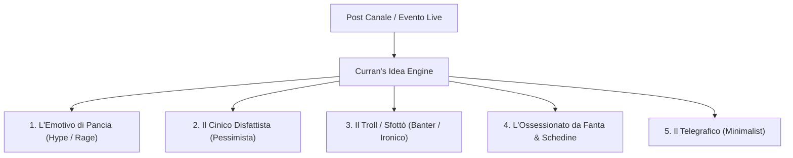

# Humans as Curran's Idea (v2.0)

[](LICENSE)
[](https://www.python.org/)

**Humans as Curran's Idea** è un motore euristico e comportamentale progettato per generare risposte realistiche da parte di bot sotto i post di canali Telegram a tema calcistico e Fantacalcio.

A differenza dei bot tradizionali (spesso rigidi, prolissi, con punteggiatura accademica e facilmente riconoscibili come IA), questo modello è stato calibrato analizzando **3.856 messaggi reali** di una vera community Telegram sportiva.

---

## 📊 I Numeri dell'Interazione Umana Reale

L'analisi statistica condotta sui messaggi del gruppo ha evidenziato metriche chiave che sfatano i pattern tipici delle IA:

| Metrica | Dati Reali del Gruppo | Regola dell'Algoritmo |
| :--- | :--- | :--- |
| **Lunghezza Mediana** | **4 parole** | Brevità estrema: vietato generare temi o papiri. |
| **Messaggi Ultra-Corti (1-3 parole)** | **45.2%** del totale | Circa metà delle reazioni deve contenere solo 1-3 parole. |
| **Messaggi Medi (4-10 parole)** | **49.9%** del totale | Commenti secchi, battute o polemiche immediate. |
| **Assenza di punto finale (`.`)** | **93.8%** dei messaggi | **Regola ferrea:** Nessun punto fermo a fine frase. |
| **Inizio con lettera minuscola** | **46.1%** dei messaggi | Minuscole naturali da digitazione rapida da smartphone. |
| **Distribuzione temporale** | 3s — 90s | I messaggi arrivano con jitter asincrono, mai in blocco. |

---

## 🎭 I 5 Archetipi Comportamentali

Sotto ogni post o evento (es. un gol, un rigore sbagliato, un'espulsione o una notizia di calciomercato), il sistema interpella 5 personalità psicologiche distinte:



1. **L'Emotivo di Pancia** *(delay: +2s - +6s | 2-6 parole)*  
   Reazione viscerale a caldo. Usa CAPS LOCK parziale o totale, punti esclamativi ed estasi/rabbia pura.  
   *Esempio:* `SEEEEEEE PROPRIO LUI GODOOO` / `NON CI CREDO MA COME SI FA DAI`

2. **Il Cinico Disfattista** *(delay: +12s - +22s | 4-8 parole)*  
   Smonta l'evento, insulta il livello dei giocatori, prevede la beffa o critica la difesa. Rigorosamente tutto minuscolo.  
   *Esempio:* `difesa del milan imbarazzante comunque dormivano tutti` / `rigore osceno comunque giocatore pippissimo`

3. **Il Troll / Sfottò** *(delay: +25s - +38s | 4-9 parole)*  
   Sbeffeggia tifosi avversari o singoli giocatori. Usa l'ironia cruda da stadio e risate testuali reali (`ahahah`).  
   *Esempio:* `questo gli esulta pure in faccia godo ahahahah` / `ma dove cazzo voleva tirarlo ahahahah`

4. **L'Ossessionato da Fanta / Schedine** *(delay: +40s - +60s | 5-10 parole)*  
   Filtra ogni evento attraverso bonus, malus, panchine o schedine bruciate.  
   *Esempio:* `ovvio mi ha bruciato la schedina sto cane` / `ovvio che mi segna contro al fanta sto maledetto`

5. **Il Telegrafico** *(delay: +60s - +90s | 1-2 parole)*  
   Monosillabi o giudizi tombali a freddo.  
   *Esempio:* `godo` / `che cesso` / `meritato` / `imbarazzante`

---

## 🚫 Blacklist Anti-Rilevamento (The Heuristics)

Il modulo `validators.py` blocca preventivamente espressioni sintetiche o televisive:
- **Bannati termini da commentatore TV / Boomer:** *"i cugini"*, *"la compagine"*, *"la dea"*, *"il biscione"*, *"il derby della madonnina"*, *"telefonatissimo"*, *"geometrico"*.
- **Divieto di emoji forzate a fine frase** (tipico pattern da bot promozionale).
- **Rimozione obbligatoria di punti finali** (`.`).

---

## 🚀 Installazione & Utilizzo

### 1. Clona il repository
```bash
git clone https://github.com/<tuo-username>/humans-as-currans-idea.git
cd humans-as-currans-idea
```

### 2. Esegui il Playground Interattivo
Non richiede dipendenze esterne pesanti (usa la libreria standard di Python):
```bash
python main.py
```

Digita qualsiasi evento:
```text
[Evento / Post Canale] > Gol inter contro il milan 1-0 calhanoglu

--- Simulazione risposte per: 'Gol inter contro il milan 1-0 calhanoglu' ---
[+4s] (L'Emotivo di Pancia)
       > SEEEEEEE PROPRIO LUI GODOOO

[+15s] (Il Cinico Disfattista)
       > difesa imbarazzante comunque dormivano tutti

[+29s] (Il Troll / Sfottò)
       > questo gli esulta pure in faccia godo ahahahah

[+48s] (L'Ossessionato da Fanta / Schedine)
       > ovvio che mi segna contro al fanta sto maledetto

[+72s] (Il Telegrafico)
       > godo
```

---

## 📁 Struttura del Progetto

```text
humans-as-currans-idea/
├── README.md               # Documentazione completa
├── LICENSE                 # Licenza MIT
├── requirements.txt        # Dipendenze
├── .gitignore              # Protezione dati personali ed export chat
├── main.py                 # Playground interattivo da terminale
└── currans_idea/
    ├── __init__.py
    ├── engine.py           # Core engine, timing jitter e simulatore
    ├── personas.py         # Configurazione dei 5 profili psicologici
    └── validators.py       # Filtri anti-rilevamento e blacklist linguistica
```

---

## 🛡️ Privacy & GDPR Notice
Questo repository **non contiene né traccia** alcun dato personale, numero di telefono o archivio di messaggi grezzi esportati da Telegram. Tutti gli export e i file JSON sono inclusi nel file `.gitignore`.

---

## 📜 Licenza
Rilasciato sotto licenza [MIT](LICENSE).
