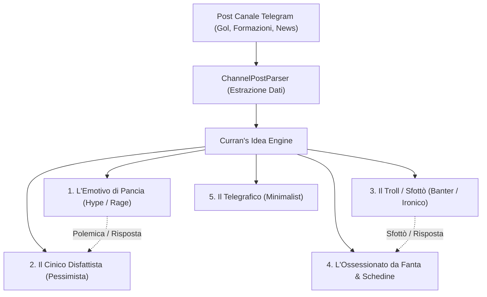

# Humans as Curran's Idea (v2.0)

[](https://github.com/CurranXMatte/humans-as-currans-idea/actions)
[](LICENSE)
[](https://www.python.org/)
[](https://fastapi.tiangolo.com)

**Humans as Curran's Idea** è un motore euristico-comportamentale e una **REST API** progettata per simulare interazioni umane e realistiche sotto i post di canali Telegram sportivi (calcio, Serie A, Champions League e Fantacalcio).

A differenza dei bot tradizionali (spesso rigidi, prolissi, con punteggiatura accademica e facilmente riconoscibili come IA), questo modello è stato calibrato su **oltre 45.000 messaggi reali** da **oltre 1.240 utenti**, integra un **Parser Semantico Intelligente per i Post di Canale**, un motore di **Thread Multi-Turno bot-to-bot** e una **REST API con documentazione Swagger interattiva**.

---

## ⚡ Novità Versione 2.0

1. **🌐 REST API completa (FastAPI + Swagger UI):** Endpoints per parsing, simulazione reazioni, e thread bot-to-bot con CORS abilitato (pronto per dashboard web o bot Telegram).
2. **🧵 Thread Multi-Turno (Discussioni nei Commenti):** I bot non si limitano a commentare il post iniziale, ma si rispondono, si citano a vicenda e litigano tra archetipi psicologici.
3. **🎲 Slot-Filling Combinatorio Dinamico (3.2M+ combinazioni):** Adattamento istantaneo a marcatore, assistman, squadre e minuto senza pattern ripetitivi.
4. **🧪 Suite di Test Automatica & CI/CD:** 11 test unitari con `pytest` e GitHub Actions su Python 3.11, 3.12, 3.13.
5. **☁️ Deploy Gratuito 24/7:** Configurazione pronta all'uso con `Dockerfile` e `render.yaml` per deployment istantaneo su Render.com o Hugging Face Spaces.

---

## 🧠 Parser Intelligente dei Post di Canale

L'algoritmo non riceve più soltanto stringhe generiche, ma esamina i post complessi del canale estraendo automaticamente i dettagli della partita e della notizia:

- **Post di GOL Live (`GOAL!`):** Estrae marcatore (`⚽️`), assistman (`👟`), minuto (`⏱️`), squadre (`🆚`) e risultato (`1-0`). I bot reagiscono menzionando direttamente il giocatore che ha segnato o l'assistman per il bonus al Fantacalcio.
- **Formazioni Ufficiali (`FORMAZIONI UFFICIALI!!`):** Rileva le squadre e genera discussioni su titolari, ballottaggi e pronostici.
- **Infortuni e Comunicati Medici (`🚑 COMUNICATO UFFICIALE`):** Identifica i traumi e commenta con l'impatto sul Fantacalcio, svincoli all'asta o critiche alla preparazione atletica.
- **Intervalli & Risultati Finali (`INTERVALLO!`, `FINALE!`):** Reazioni a freddo su ribaltoni, prestazione delle difese e sfottò agli sconfitti.

---

## 📊 I Numeri dell'Interazione Umana Reale (Dataset da oltre 45 mila messaggi)

| Metrica | Dati Reali (Oltre 45k messaggi reali) | Regola dell'Algoritmo |
| :--- | :--- | :--- |
| **Lunghezza Mediana** | **4 parole** | Brevità estrema: vietato generare temi o papiri. |
| **Messaggi Ultra-Corti (1-3 parole)** | **43.1%** del totale | Quasi metà delle reazioni contiene solo 1-3 parole. |
| **Messaggi Medi (4-10 parole)** | **40.7%** del totale | Commenti secchi, battute veloci o polemiche immediate. |
| **Messaggi Telegrafici (1-2 parole)** | **>29%** (oltre 13.000 messaggi) | Giudizi tombali a caldo (*godo*, *che cesso*, *meritato*). |
| **Assenza di punto finale (`.`)** | **90.7%** dei messaggi | **Regola ferrea:** Nessun punto fermo a fine frase. |
| **Inizio con lettera minuscola** | **28.5%** dei messaggi | Minuscole naturali da digitazione rapida da smartphone. |
| **Distribuzione temporale** | 2s — 90s | I messaggi arrivano con jitter asincrono, mai in blocco. |

---

## 🎭 I 5 Archetipi Comportamentali



1. **L'Emotivo di Pancia** *(delay: +2s - +6s)*  
   Reazione viscerale a caldo: caps lock, esclamativi.  
   *Esempio:* `SEEEEEEE LAUTARO SEI UN FENOMENO GODO TROPPO`

2. **Il Cinico Disfattista** *(delay: +12s - +22s)*  
   Smonta l'azione, disillusione totale, tutto minuscolo.  
   *Esempio:* `difesa del milan imbarazzante dormivano tutti come al solito`

3. **Il Troll / Sfottò** *(delay: +25s - +38s)*  
   Sbeffeggia tifosi avversari o singoli giocatori usando risate testuali reali (`ahahah`).  
   *Esempio:* `lautaro martinez li manda tutti a dormire ahahah muti`

4. **L'Ossessionato da Fanta / Schedine** *(delay: +40s - +60s)*  
   Bonus, malus, panchine e schedine bruciate.  
   *Esempio:* `ovvio che mi segna contro lautaro sto cane`

5. **Il Telegrafico** *(delay: +60s - +90s)*  
   Nome del marcatore o giudizio tombalo secco (1-2 parole).  
   *Esempio:* `godo` / `meritato` / `paracarro`

---

## 🌐 REST API Endpoints

Puoi avviare il server REST API locale con un solo comando:
```bash
python main.py --serve
# oppure: uvicorn currans_idea.api:app --reload
```
La documentazione interattiva OpenAPI / Swagger sarà disponibile su: **`http://localhost:8000/docs`**

### 1. `POST /api/v1/simulate`
Simula le reazioni immediate dei 5 archetipi con delay temporali umani.
```bash
curl -X POST "http://localhost:8000/api/v1/simulate" \
  -H "Content-Type: application/json" \
  -d '{"text": "GOAL! ⚽️ Lautaro Martinez ⏱️ 34'\'' Inter 🆚 Milan"}'
```
**Risposta:**
```json
{
  "event_type": "GOAL",
  "parsed_metadata": {
    "scorer": "Lautaro Martinez",
    "team_home": "Inter",
    "team_away": "Milan",
    "minute": "34'"
  },
  "reactions": [
    {
      "persona_id": 1,
      "persona_name": "L'Emotivo di Pancia",
      "delay_seconds": 3,
      "message": "SEEEEEEE LAUTARO MARTINEZ SEI UN FENOMENO"
    },
    {
      "persona_id": 2,
      "persona_name": "Il Cinico Disfattista",
      "delay_seconds": 18,
      "message": "comunque la difesa del milan dorme in piedi tanto mo pareggiano"
    }
  ]
}
```

### 2. `POST /api/v1/thread`
Genera un thread multi-turno di commenti in cui le diverse persone si rispondono e si provocano a vicenda.
```bash
curl -X POST "http://localhost:8000/api/v1/thread" \
  -H "Content-Type: application/json" \
  -d '{"text": "GOAL! ⚽️ Lautaro Martinez ⏱️ 34'\'' Inter 🆚 Milan", "max_replies": 3}'
```

### 3. `POST /api/v1/parse`
Estrae le entità del post (squadre, marcatori, assist, minuto, punteggio, tipo di evento).

---

## 💻 Utilizzo da CLI

```bash
# Modalità interattiva (incolla post multilinea)
python main.py

# Simulazione rapida di un post
python main.py --post "GOAL! ⚽️ Vlahovic ⏱️ 12' Juventus 🆚 Lazio"

# Simulazione di una discussione bot-to-bot (Thread multi-turno)
python main.py --thread "GOAL! ⚽️ Leao ⏱️ 88' Milan 🆚 Roma"

# Avvio del server API
python main.py --serve --port 8000
```

---

## ☁️ Deploy Gratuito su Render.com (in 2 minuti)

1. Crea un account gratuito su [Render.com](https://render.com).
2. Clicca su **New +** > **Web Service**.
3. Collega il tuo repository GitHub `CurranXMatte/humans-as-currans-idea`.
4. Render rileverà in automatico il file `render.yaml` e configurerà:
   - **Build Command:** `pip install -r requirements.txt`
   - **Start Command:** `uvicorn currans_idea.api:app --host 0.0.0.0 --port $PORT`
5. Clicca su **Create Web Service**: la tua API sarà online con HTTPS gratuito h24 all'indirizzo `https://humans-as-currans-idea.onrender.com/docs`!

---

## 🧪 Esecuzione dei Test Unitari

```bash
pytest -v tests/
```

Tutti gli 11 test unitari coprono parsing, euristiche, thread ad albero e chiamate API FastAPI.

---

## 🛡️ Privacy & GDPR Notice
Questo repository **non contiene né traccia** alcun dato personale, numero di telefono o archivio di messaggi grezzi esportati da Telegram. Tutti gli export e i file JSON sono protetti nel file `.gitignore`.

---

## 📜 Licenza
Rilasciato sotto licenza [MIT](LICENSE).
